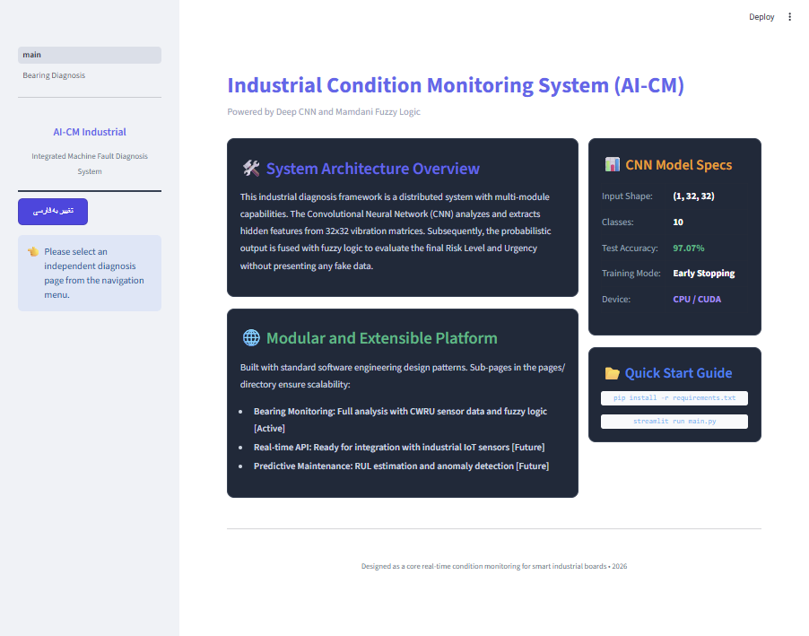
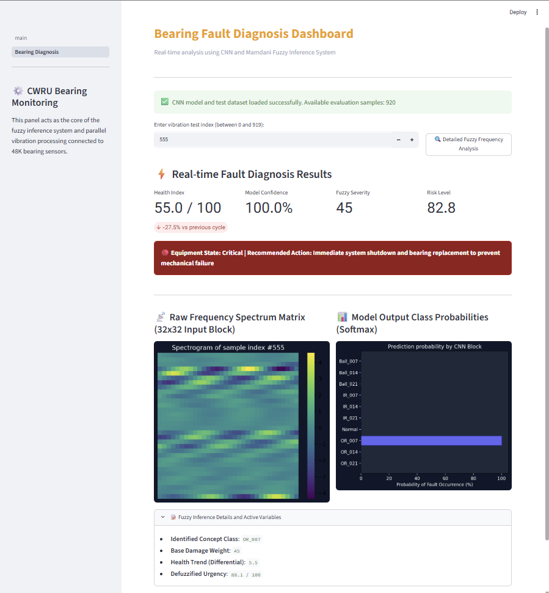
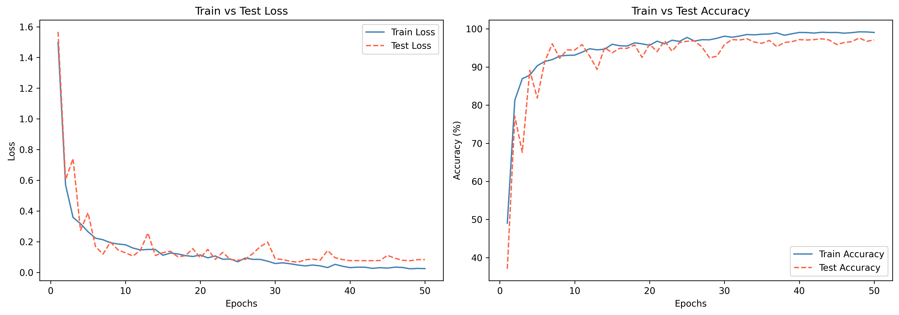
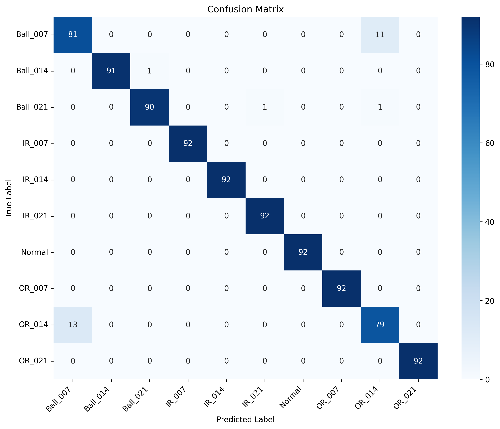

# 🛠️ Intelligent Bearing Fault Diagnosis System


An advanced hybrid system for industrial equipment health monitoring, combining **Deep Convolutional Neural Networks (CNN)** for fault classification and **Mamdani Fuzzy Inference System** for intelligent decision-making and risk assessment.

## 📌 Overview

This project was developed as a Bachelor's Thesis in Computer Science. It provides an end-to-end pipeline from raw vibration signal processing to a fully interactive, bilingual (English/Persian) industrial dashboard.

The system classifies bearing faults into 10 distinct classes (Normal, and Ball, Inner Race, Outer Race faults with varying diameters) using the **Case Western Reserve University (CWRU)** dataset.

### Key Features:
- **Deep Learning Engine:** A custom 3-block CNN architecture built with PyTorch, achieving **97.07% test accuracy**.
- **Fuzzy Logic Controller:** A comprehensive 44-rule Mamdani Fuzzy Inference System that translates raw model probabilities into actionable insights (Health Index, Risk Level, Urgency).
- **Bilingual Dashboard:** An interactive Streamlit dashboard supporting both English and Persian languages with dynamic RTL/LTR styling.
- **Real-time Monitoring:** Simulates real-time analysis of 32x32 vibration matrix inputs, providing immediate maintenance recommendations.

---

## 🏗️ System Architecture

1. **Signal Processing:** Vibration signals are segmented into 32x32 matrices and normalized using Z-score.
2. **CNN Classification:** The model extracts hidden features and outputs class probabilities via Softmax.
3. **Fuzzy Inference:** Inputs (Health Index, Model Confidence, Fault Severity, and Health Trend) are fed into the Fuzzy system.
4. **Decision Support:** The system outputs Risk Level, Urgency, and a clear Recommended Action (e.g., "Immediate system shutdown", "Schedule maintenance").

---

## 📊 Results & Visualizations

The model achieved an exceptional **97.07%** accuracy on the test dataset, demonstrating high precision and recall, particularly on Inner Race (IR) and Outer Race (OR) faults. The Fuzzy logic system successfully mitigates false alarms by considering model confidence and health trends.

### 1. Interactive Bilingual Dashboard

**Main Page (System Overview):**


**Bearing Diagnosis & Fuzzy Analysis Page:**


### 2. Training Performance (Loss & Accuracy)


### 3. Confusion Matrix


---

## 📂 Repository Structure

```text
bearing-fault-diagnosis/
│
├── data/                  # Place the CWRU_48k_load_1_CNN_data.npz here
├── docs/                  # Bachelor's Thesis PDF report
├── figures/               # Generated plots and dashboard screenshots
├── notebooks/
│   └── CWRU.11.ipynb      # Main notebook: Training, Evaluation, and saving the model
├── src/
│   ├── bearing_module.py  # Core CNN architecture and Fuzzy Logic System
│   └── bearing_cnn_model.pth # Trained PyTorch weights (Generated by the notebook)
├── dashboard/
│   ├── main.py            # Streamlit main entry point (Bilingual)
│   └── pages/
│       └── 1_Bearing_Diagnosis.py # Detailed fault diagnosis page
├── requirements.txt
└── README.md